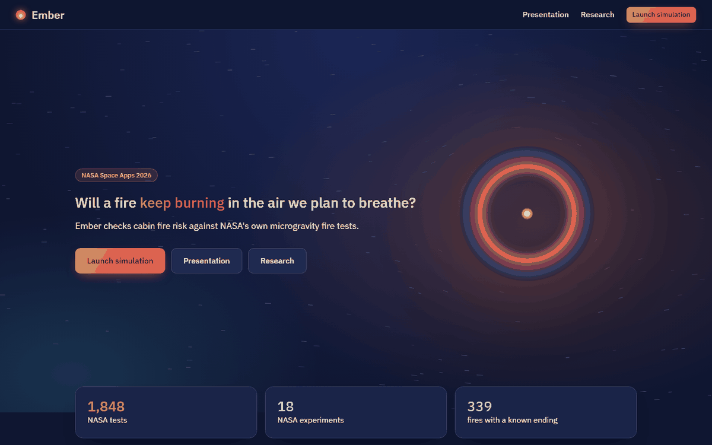
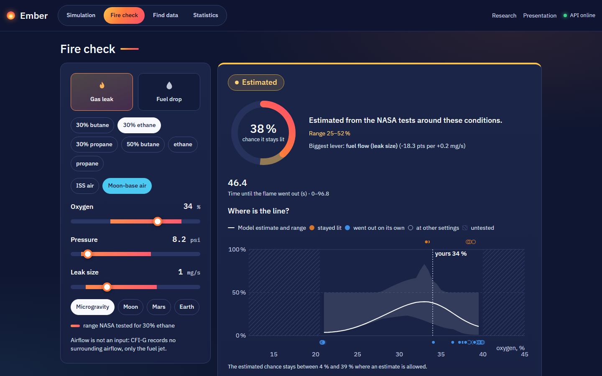
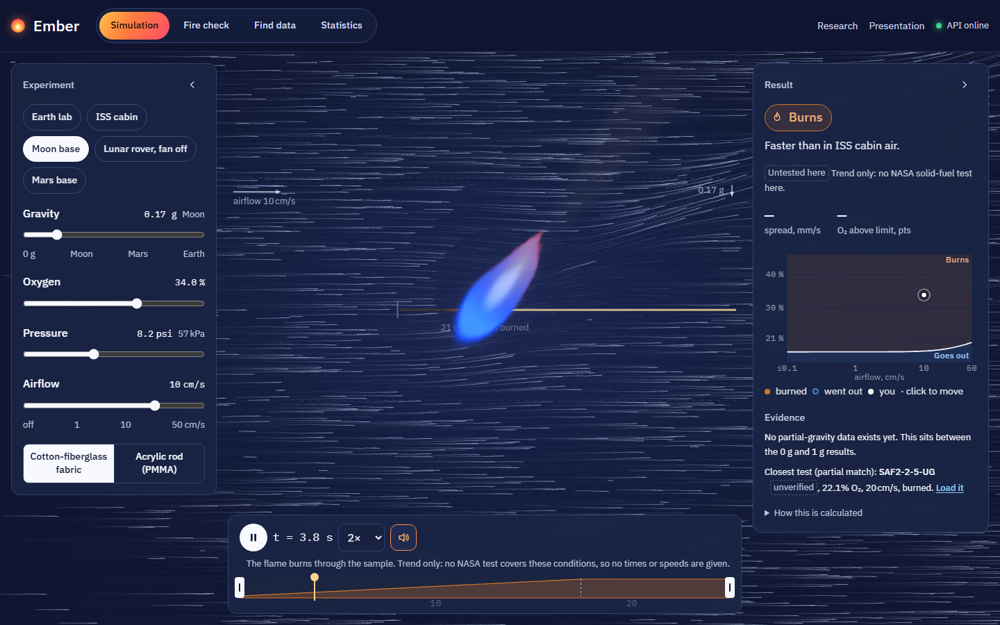
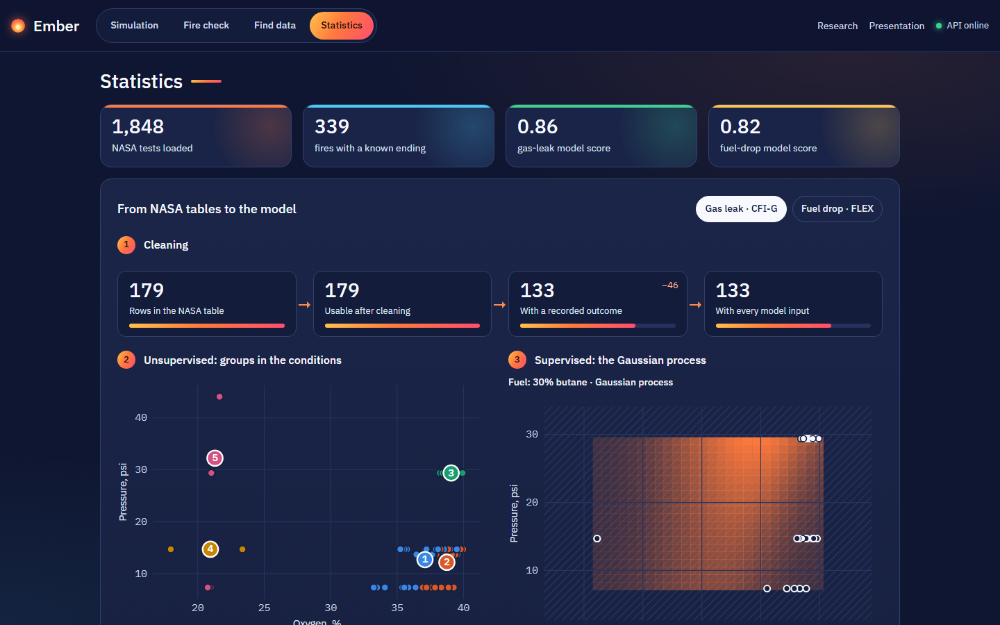
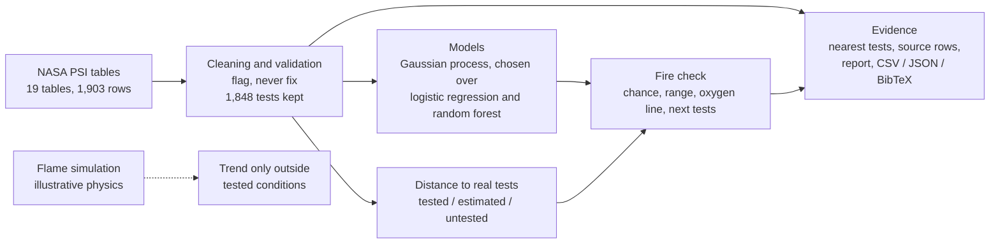
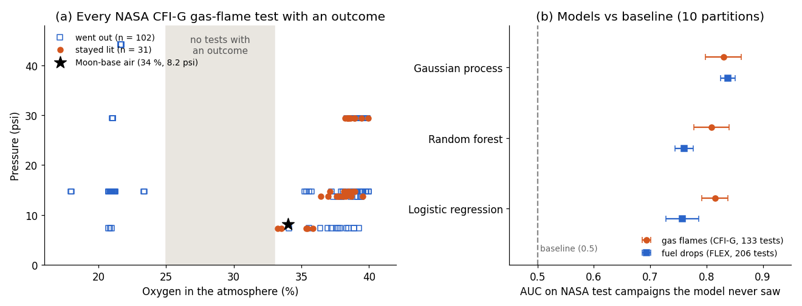

# Ember

**Will a small fire keep burning in the air planned for a Moon base? Ember answers from NASA's own microgravity fire tests, and says plainly where those tests stop.**

[](https://www.spaceappschallenge.org/2026/challenges/flame-in-freefall/)
[](https://mohamad-755--ember.modal.run)
[](LICENSE)



[Live demo](https://mohamad-755--ember.modal.run) · 2-minute video: TBD · [Technical report](docs/TECHNICAL_REPORT.md) · [Method in plain language](docs/methods/README.md)

## The problem

Moon and Mars habitats are planned with more oxygen at lower pressure than the space station: about 34 % oxygen at 8.2 psi, against 21 % at 14.7 psi. Oxygen feeds fire, and a crew cannot leave a burning habitat. NASA has run hundreds of fire experiments in microgravity, and the results are public through [Physical Sciences Informatics (PSI)](https://psi.nasa.gov), but they sit in many tables, each with its own format, codes and errors, so they are hard to compare or apply to a design question. No combustion test has been run at Moon or Mars gravity yet. ([Challenge: Flame in Freefall](https://www.spaceappschallenge.org/2026/challenges/flame-in-freefall/))

## What it does

- **Check a fire against NASA's tests.** Choose a gas leak or a fuel drop, the fuel, oxygen, pressure and size. Ember answers with one of three labels: **Tested** (NASA ran nearly this; the real result is the answer), **Estimated** (between tests; a validated model gives a chance with a range) or **Untested** (outside the tests; no number).
- **See where the line is and what to test next.** The fire check shows the oxygen level at which the chance passes 50 %, and the experiments that would narrow the answer most.
- **Open the evidence.** Every answer lists the closest NASA tests; one click opens each test's row in its NASA table, and the report downloads as a printable page.
- **Watch a flame.** The simulation shows how gravity, oxygen, pressure and airflow change a flame on fabric or acrylic. It illustrates trends; it is not fitted to NASA data and shows no numbers outside tested conditions.
- **Find the research.** Search 19 NASA tables, NASA reports and papers with credibility scores, ask a question answered only from NASA passages, and export CSV, JSON or BibTeX.

| Fire check (Moon-base air, small gas leak) | Simulation (Moon base, flame lit) | Statistics |
|---|---|---|
|  |  |  |

## How it works



Only two NASA tables record whether the fire kept going: **CFI-G** gas-jet flames (a small gas leak) and **FLEX** fuel droplets (a spilled liquid). Ember trains its models on those, validates them on whole NASA test campaigns they never saw, and gives a number only near real tests of the same fuel. Everything else comes straight from NASA's tables and documents. What is **not** from NASA data: the flame simulation (a simple flame model with published starting values, for intuition) and the inputs you choose.

## Data

All test data are NASA PSI experimental tables, read as published (NASA open data under the [PSI terms of use](https://psi.nasa.gov)): 1,848 usable tests.

| Investigation | PSI study · DOI | Tests used | Used for |
|---|---|---|---|
| FLEX (fuel droplets) | PSI-69 · [10.60555/mbq8-0451](https://doi.org/10.60555/mbq8-0451) | 273 (206 with an outcome) | **model** (drop burns to the end), evidence |
| CFI-G (gas-jet flames) | PSI-159 · [10.60555/cyt1-kh64](https://doi.org/10.60555/cyt1-kh64) | 333 (133 with an outcome) | **model** (flame stays lit), evidence |
| FLEX-2 | PSI-68 · [10.60555/byp8-h018](https://doi.org/10.60555/byp8-h018) | test plan only | coverage |
| CFI | PSI-39 · [10.60555/m6pj-a914](https://doi.org/10.60555/m6pj-a914) | 79 | evidence |
| ACME: Flame Design, Burning Rate Emulator, CLD Flame, s-Flame | PSI-10, 20, 21, 23 · [w4zy-bt45](https://doi.org/10.60555/w4zy-bt45), [vb93-3y72](https://doi.org/10.60555/vb93-3y72), [23e1-9950](https://doi.org/10.60555/23e1-9950), [k57n-p030](https://doi.org/10.60555/k57n-p030) | 207 + 41 + 32 + 23 | evidence |
| E-FIELD Flames | PSI-22 · [10.60555/se5a-8c73](https://doi.org/10.60555/se5a-8c73) | 20 | evidence |
| SPICE | PSI-107 · [10.60555/9kbh-e962](https://doi.org/10.60555/9kbh-e962) | 426 | evidence |
| SLICE | PSI-106 · [10.60555/pm12-rg61](https://doi.org/10.60555/pm12-rg61) | 12 | evidence |
| BASS-II, BASS (solids) | PSI-25, 26 · [4qc4-de67](https://doi.org/10.60555/4qc4-de67), [58h4-dy80](https://doi.org/10.60555/58h4-dy80) | 129 + 122 | evidence (no outcome recorded) |
| SAFFIRE-1, 2, 3 (large solid fires) | PSI-98, 99, 100 · [0t15-1z43](https://doi.org/10.60555/0t15-1z43), [2chp-m469](https://doi.org/10.60555/2chp-m469), [040q-4h36](https://doi.org/10.60555/040q-4h36) | 2 + 18 + 2 | evidence |
| SAME, SAME-R (smoke) | PSI-102, 101 · [gd4k-8h62](https://doi.org/10.60555/gd4k-8h62), [2np7-jv14](https://doi.org/10.60555/2np7-jv14) | 20 + 109 | evidence |

Also used: NASA's *A Researcher's Guide to: Combustion Science* (2015) and 33 NASA Technical Reports Server records, quoted by page. Kept apart and never used to train: five ZARM drop-tower flame-spread rates ([doi:10.5281/zenodo.18479713](https://doi.org/10.5281/zenodo.18479713), CC BY-NC 4.0) and Earth limiting-oxygen values from *Perry's Chemical Engineers' Handbook*.

## Validation

**Data quality.** 1,903 rows read, 55 excluded (44 duplicates, 11 physically impossible values such as 0 mmHg pressure), 1,848 kept. Kept rows that look odd carry a written flag instead of being changed (flags by rule: 131 missing outcome, 7 implausible, 6 gas fractions that do not sum to 100 %, 1 extinction diameter larger than the starting drop).

**Models against a baseline.** The baseline ignores the conditions and always predicts the average. Scores are on whole NASA test campaigns held out from training, averaged over 10 different splits. AUC (0.5 = chance) measures ranking; the Brier score (lower is better) measures whether the probabilities are right. A model is used only if it beats the baseline on both Brier score and log loss.

| Question | Tests · campaigns | Chosen model | AUC | Brier (baseline) |
|---|---|---|---|---|
| Gas-jet flame stays lit (CFI-G) | 133 · 11 | Gaussian process | 0.830 ± 0.032 | 0.123 (0.179) |
| Fuel drop burns to the end (FLEX) | 206 · 12 | Gaussian process | 0.838 ± 0.013 | 0.094 (0.114) |



**Main finding, checked without any model.** No gas flame stayed lit below 30 % oxygen: 0 of 41 tests, against 29 of 89 at 35–40 % (Fisher exact test, p = 5.4 × 10⁻⁶). The lowest oxygen at which one stayed lit is 33.2 %, and leaving out any one campaign moves it only to 33.2–35.4 %. There are **no** gas-jet tests with an outcome between 25 % and 33 % oxygen, the Moon-base range: the data supports "no flame stayed lit below 30 % in these tests", not "flames need 33 %". Oxygen share predicts the outcome far better than oxygen partial pressure (gas-jet AUC 0.815 against 0.649).

Reproduce every number: `python scripts/evaluate_methods.py` (writes [docs/methods/results.md](docs/methods/results.md)); figures: `python scripts/readme_assets.py`. Full write-up: [docs/TECHNICAL_REPORT.md](docs/TECHNICAL_REPORT.md).

## Limitations

- **Microgravity only.** No combustion test exists at Moon or Mars gravity, so those cases are always untested.
- **Gas leaks and fuel drops only.** Solid materials (fabric, plastic, wiring), the main cabin hazard, have no model: their NASA tables do not record pressure and outcome together. Test fuels stand in for cabin fluids.
- **Small data.** 31 and 27 fires that kept going; for gas jets the three models are within noise of each other, and the ranges are rough.
- **The simulation is illustrative.** It uses published starting values, not a fit to NASA tests, and it is not a computational fluid dynamics (CFD) solver.
- **Airflow is not an input to the fire check:** the outcome-labelled tests have no airflow variation.

More in [docs/LIMITS.md](docs/LIMITS.md).

## Quick start

You need Python 3.11+ and Node 20+. No API keys and no login.

```
git clone https://github.com/Hassanbil999/Ember.git
cd Ember
python run.py start          # installs what is missing, loads the data, trains the models → http://localhost:8000
```

Tests: `python run.py test`. Lint: `python run.py lint`. Container: `docker compose up --build` (not run on the build machine).

<details>
<summary>More commands</summary>

| Task | Command |
|---|---|
| Dev servers (API with reload + Vite) | `python run.py dev` |
| Load data (offline, no key) | `python run.py ingest [canonical\|existing\|psi\|ntrs\|text\|seed\|curate\|fit\|predict\|index\|all]` |
| Retrain the fire-check models (about 2 min) | `python run.py ingest predict` |
| Re-download the PSI tables and check their checksums | `python run.py fetch` |
| Regenerate the method numbers / README figures | `python scripts/evaluate_methods.py` / `python scripts/readme_assets.py` |
| Check the typography rules on the rendered pages | `python scripts/typo_audit.py --strict` |
| Optional AI (summary and Ask) | set `ANTHROPIC_API_KEY`, or a free OpenAI-compatible key (`LLM_API_KEY`, `LLM_BASE_URL`, `LLM_MODEL`), in `.env` |

</details>

## Project structure

```
backend/      FastAPI app: cleaning pipeline, catalog, fire-check models (predict/), simulator, AI with citations
web/          React + Vite web app: landing, simulation, fire check, find data, statistics
config/       dataset definitions, variables, outside reference values
data/raw/     NASA PSI tables and reports, checksum-pinned
scripts/      data download, method evaluation, README figures, typography audit
docs/         method notes, technical report, limits, audit, decisions
deploy/       Modal deployment of the container
```

<details>
<summary>Glossary</summary>

- **PSI** (Physical Sciences Informatics): NASA's public archive of physical-science experiments run on the space station.
- **Microgravity:** the near-weightless state in orbit. Hot gas does not rise, so a flame gets oxygen only by slow mixing or a fan.
- **Partial pressure (of oxygen):** oxygen share × total pressure. NASA materials testing, and these models, find the oxygen share predicts flammability better.
- **LOI / limiting oxygen:** the lowest oxygen share at which a fuel can keep burning.
- **Flammability limit:** the boundary between conditions where a flame survives and where it dies.
- **Campaign:** a batch of NASA tests run together with the same hardware; Ember validates on campaigns the model never saw.
- **cm/s, psi:** airflow speed in centimetres per second; pressure in pounds per square inch (14.7 psi is sea level).

</details>

## Team

TBD: names and roles.

## Citation

If you use Ember or its cleaned data, please cite it (GitHub shows "Cite this repository" from [CITATION.cff](CITATION.cff)) and cite the NASA PSI datasets by their DOIs above.

## License and acknowledgments

Code: [MIT](LICENSE). Data: NASA PSI experimental data under the PSI terms of use; the ZARM dataset is CC BY-NC 4.0.

Built for the [NASA International Space Apps Challenge 2026](https://www.spaceappschallenge.org/2026/challenges/flame-in-freefall/) on data from NASA Physical Sciences Informatics, NASA's Researcher's Guide to Combustion Science and the NASA Technical Reports Server.

### Use of AI, references and libraries

The complete list (every NASA table with its DOI, the 33 NASA reports, outside data, methods, software and AI use) is in [docs/REFERENCES.md](docs/REFERENCES.md).

#### Use of AI (SI)
- **Code:** this repository's code, tests and documentation were written with the help of an AI coding assistant, **Claude (Anthropic), through Claude Code**. Commits made with it carry a `Co-Authored-By: Claude` line. The team chose the idea, the data and the decisions, and reviewed the results.
- **In the app:** the AI summary and *Ask* use a large language model (Claude via the Anthropic API, or a free OpenAI-compatible provider such as Groq or Google AI Studio). Every AI sentence must cite a NASA source and use only numbers found in it, or it is removed (Decision S). Without a key the app uses templates. Optional AI extraction of test points from NASA PDFs stays *unverified* until a person checks it.
- **Not AI:** the fire-check estimates are classical statistical models (scikit-learn) trained on NASA tables; the report contains no generated prose. No AI-generated images, audio or video are used, and no NASA logos or branding are reproduced.

#### NASA data
- NASA Physical Sciences Informatics (PSI) experimental tables, https://psi.nasa.gov: FLEX PSI-69 (doi:10.60555/mbq8-0451), FLEX-2 PSI-68 (10.60555/byp8-h018), CFI PSI-39 (10.60555/m6pj-a914), CFI-G PSI-159 (10.60555/cyt1-kh64), ACME Flame Design PSI-10 (10.60555/w4zy-bt45), ACME BRE PSI-20 (10.60555/vb93-3y72), ACME CLD Flame PSI-21 (10.60555/23e1-9950), ACME E-FIELD PSI-22 (10.60555/se5a-8c73), ACME s-Flame PSI-23 (10.60555/k57n-p030), BASS-II PSI-25 (10.60555/4qc4-de67), BASS PSI-26 (10.60555/58h4-dy80), SAFFIRE-1 PSI-98 (10.60555/0t15-1z43), SAFFIRE-2 PSI-99 (10.60555/2chp-m469), SAFFIRE-3 PSI-100 (10.60555/040q-4h36), SAME-R PSI-101 (10.60555/2np7-jv14), SAME PSI-102 (10.60555/gd4k-8h62), SLICE PSI-106 (10.60555/pm12-rg61), SPICE PSI-107 (10.60555/9kbh-e962). Checksums in `data/raw/psi_manifest.json`.
- NASA, *A Researcher's Guide to: Combustion Science* (2015), NP-2015-10-034-JSC.
- NASA Technical Reports Server (NTRS) records and report text: `data/raw/ntrs/` (33 records).

#### Other data (kept apart from NASA data, never used to train a model)
- ZARM drop tower, Bremen: Ries, Krieger, Meyer, Eigenbrod (2026), Zenodo doi:10.5281/zenodo.18479713, CC BY-NC 4.0 (funded by the German Space Agency at DLR).
- Earth limiting-oxygen reference values: Green & Perry, *Perry's Chemical Engineers' Handbook*, 8th ed. (McGraw-Hill, 2007), §23 (`config/outside_reference.yaml`).
- Starter rows in `data/seed.json` (from the team's prototype), labelled *placeholder / unverified*.

#### Code and libraries
- Python: FastAPI, ruff (lint), Uvicorn, Pydantic, pandas, PyArrow, NumPy, SciPy, scikit-learn, DuckDB, PyYAML, rank-bm25, PyMuPDF, openpyxl, httpx, Anthropic Python SDK, pytest.
- Web: React 18, Vite, TypeScript, Vitest, Playwright. Fonts: Barlow Condensed, IBM Plex Sans, IBM Plex Mono (Google Fonts).
- Hosting: Docker, Modal.
- Methods cited in `docs/methods/`: grouped cross-validation, Brier score and calibration practice from clinical prediction research (van den Goorbergh et al. 2022; Riley et al. 2019), OECD QSAR applicability-domain principle.

